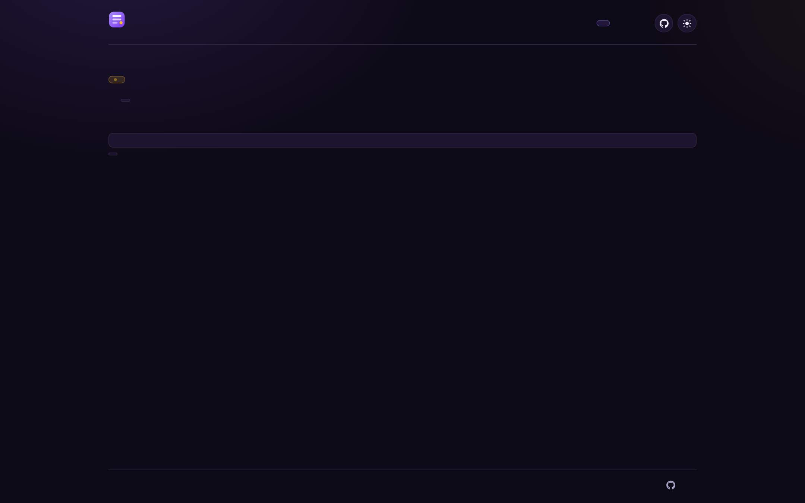
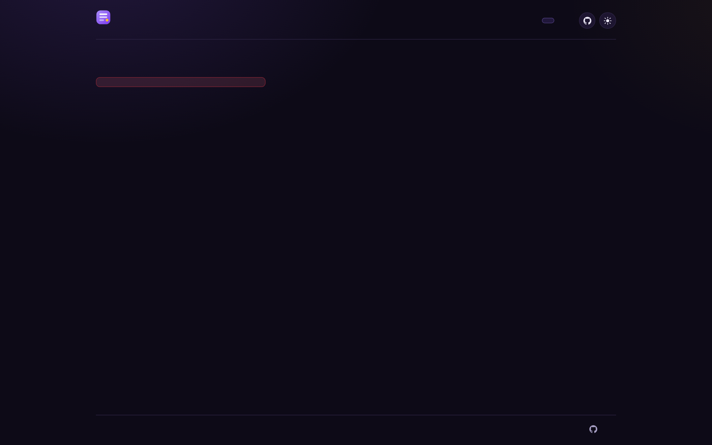
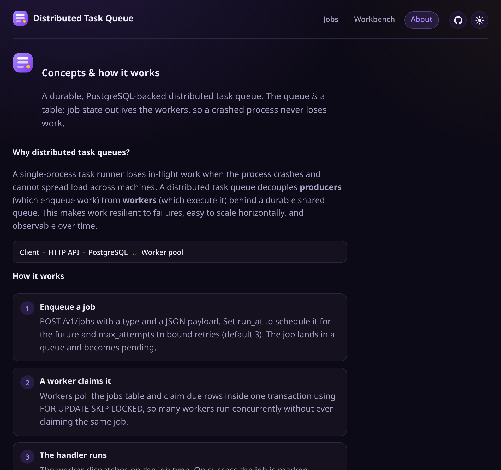

<h1 align="center">
  
  <br>
  Distributed Task Queue
</h1>

<p align="center">A durable, PostgreSQL-backed distributed task queue — enqueue jobs, run workers, and survive crashes without losing work.</p>

<p align="center">
  <a href="https://github.com/fiwon123/distributed-task-queue/actions/workflows/ci.yml"></a>
  <a href="https://go.dev/"></a>
  <a href="https://www.postgresql.org/"></a>
  <a href="https://swagger.io/specification/"></a>
  <a href="https://react.dev/"></a>
  <a href="LICENSE"></a>
</p>
<p align="center">
  <a href="https://github.com/fiwon123/distributed-task-queue/stargazers"></a>
  <a href="https://github.com/fiwon123/distributed-task-queue/issues"></a>
  <a href="https://github.com/fiwon123/distributed-task-queue/commits/dev"></a>
</p>

<p align="center">
  
</p>


## Problem

A single-process task runner loses in-flight work when the process crashes and
cannot spread load across machines. A durable queue keeps the job state in a
shared database so that work outlives the workers running it: a job claimed by a
worker that then died becomes runnable again, retries are bounded, and failed
jobs land somewhere inspectable instead of vanishing.

## Table of contents

- [Problem](#problem)
- [What you can do](#what-you-can-do)
- [Screenshots](#screenshots)
- [Quickstart](#quickstart)
- [Architecture](#architecture)
- [Concepts & how it works](#concepts--how-it-works)
- [API](#api)
- [API reference](#api-reference)
- [Design choices](#design-choices)
- [Build order](#build-order)
- [Development](#development)
- [Building the dashboard](#building-the-dashboard)
- [License](#license)


## Screenshots

**Jobs console (dark)** — queues, job list with status/priority/type, and enqueue form.


**Job detail (dark)** — live job detail showing attempts, lease context, payload, and last error.



**Workbench (dark)** — API request runner built from the served OpenAPI spec.



**Concepts & how it works (dark)** — theory, architecture mapping, core concepts, job lifecycle diagram, and key characteristics.



## What you can do

Once built, you can run the API and one or more workers and:

- enqueue jobs (a `type` plus a JSON payload), optionally scheduled for later;
- poll a job's status, attempts, and last error;
- run several workers concurrently against one database without double-claiming;
- watch failed jobs retry with exponential backoff;
- recover jobs abandoned by a worker killed mid-job, via leases;
- inspect dead-lettered jobs and requeue them;
- read per-queue statistics.

## Quickstart

There are two independent Docker Compose stacks, gated behind separate Compose
profiles. Both use the same `db` service, so run one at a time.

### Production (the real app)

Builds the runtime image and runs the API + worker:

```bash
make prod-up      # db + api + worker (compose profile: prod)
make demo         # enqueue a few jobs so the dashboard has something to show
```

Then open:

- **Dashboard** — <http://localhost:8080/>
- **API docs** — <http://localhost:8080/docs>

Follow the worker as it processes the demo jobs with `make prod-logs`. Set
`API_PORT` if `8080` is taken on the host. Tear down with `make prod-down`
(keeps data) or `make prod-reset` (also deletes the Postgres volume).

Running several projects side by side? Copy the committed template to `.env`
(`cp .env.example .env`) and adjust the host ports — it pre-fills the
compose-interpolated variables with conflict-free values
(`15173` / `18081` / `18080` / `15432`). `docker compose` reads `.env`
automatically and the Makefile / `scripts/demo.sh` honor it when printing URLs
or seeding jobs.

Running two checkouts of this repo on one machine? Give each its own
`PROJECT_NAME` (commented in the template) — it prefixes every Docker resource
(containers, network, Postgres volume), so a second checkout with its own name
gets isolated resources instead of container-name conflicts and a shared
database. `DEV_IMAGE` does the same for the local dev image tag. `PROJECT_NAME`
isolates Docker resources only — host ports are separate, so also give each
checkout its own `FRONTEND_PORT` / `HOST_PORT` / `API_PORT` / `POSTGRES_PORT`.

### Development (edit code, fast reload)

The dev stack runs the API through `air` (fast reload), a worker so enqueued jobs
actually get processed, and a **Vite dev server** for the dashboard:

```bash
make dev-up       # db + dev sandbox + worker + Vite (compose profile: dev)
API_URL=http://localhost:8081 make demo   # sandbox API listens on HOST_PORT (:8081)
```

Then open:

- **Console (Vite, hot reload)** — <http://localhost:5173/> (override with `FRONTEND_PORT`)
- **Dev API (air)** — <http://localhost:8081/> (override with `HOST_PORT`)
- **API docs** — <http://localhost:8081/docs>

Editable per project via `.env` (see the note above): `cp .env.example .env`
then change `FRONTEND_PORT` / `HOST_PORT` to whatever your other projects are
not using.

Both sides hot-reload: editing `frontend/src` updates the browser via HMR, and
editing a Go handler rebuilds through `air`. Vite proxies `/v1`, `/openapi`,
`/docs`, and `/swagger` to the dev API, so the console's `/workbench` loads the
served spec on the Vite origin. The worker is a built image, so it picks up worker
changes on the next `make dev-up`.

For a shell inside the sandbox use `make shell`; to run opencode use
`make opencode`; follow the Vite/API/worker logs with `make dev-log`.

`make demo` needs `curl` on the host and is safe to run repeatedly. Because each
stack is behind its own profile, `make prod-up` never starts the dev sandbox (and
vice versa).

## Architecture

```text
Client (curl / HTTP client)
  ↓
HTTP API (POST /v1/jobs, GET /v1/jobs/{id}, GET /v1/jobs, POST /v1/jobs/{id}/requeue, DELETE /v1/jobs/{id}, DELETE /v1/queues/{name}/jobs, GET /v1/queues, GET /v1/queues/{name}/stats, GET /v1/workers, /healthz, /readyz)
  ↓
PostgreSQL (jobs table — the queue itself: due jobs, leases, attempts, status; workers table for registry)
  ↕
Worker pool (claim due jobs with FOR UPDATE SKIP LOCKED, renew leases via heartbeat, run handlers, update status)
```

Key: Postgres is the queue (no external broker). Claims are atomic in a short transaction with `FOR UPDATE SKIP LOCKED`. Leases (`locked_until`) + heartbeat recover abandoned work; retries use exponential backoff; jobs that exhaust `max_attempts` move to `dead` and can be requeued.

## Status

**MVP complete.** The full feature set is implemented and tested: the `jobs`
table, `POST /v1/jobs` / `GET /v1/jobs/{id}`, a worker pool that claims jobs with
`FOR UPDATE SKIP LOCKED`, exponential-backoff retries, lease-based recovery of
jobs abandoned by a dead worker, dead-letter requeue, per-queue stats, graceful
shutdown, and a small web console (bundled into the API binary) for browsing
queues and jobs, enqueueing new jobs, and watching a job's status live.

The whole stack also runs with one command — `make prod-up` starts Postgres, the
API, and a worker via Docker Compose — and the API serves its own OpenAPI
document at `/openapi.yaml` with an interactive UI at `/docs`. See
[Two ways to run it](#two-ways-to-run-it) and [API reference](#api-reference).

## Stack

- **Language**: Go (standard toolchain)
- **Storage**: PostgreSQL — the queue is a table, not an in-memory list
- **DB access**: pgx (v5); `FOR UPDATE SKIP LOCKED` for atomic claims
- **HTTP API**: `net/http`
- **Dashboard**: a small React + Vite single-page app under `frontend/`, embedded
  into the API binary with `go:embed` (no Node needed at runtime)
- **Workers**: in-process goroutine pool polling the jobs table
- **Local environment**: Docker Compose dev sandbox + a Postgres service
- **Testing**: standard `testing` package (`go test`) plus Vitest for the
  dashboard; Postgres integration tests gated behind a build tag

## API

All five JSON endpoints are implemented. The console is served at `/` with
client-side routes `/jobs/{id}` (live job detail) and `/workbench` (a request
runner built from the spec), and the API serves its own documentation: the
OpenAPI 3 document at `/openapi.yaml` and `/openapi.json`, and an offline
Swagger UI at `/docs` (assets vendored under `docs/swagger/`, so the page needs
no internet access).

| Method | Path | Purpose |
|---|---|---|
| `POST` | `/v1/jobs` | Enqueue a job (`type`, `payload`, optional `run_at`/`max_attempts`) |
| `GET` | `/v1/jobs/{id}` | Job status, attempts, last error, timestamps |
| `GET` | `/v1/jobs` | List jobs, newest first (`queue`, `status`, `limit` filters) |
| `POST` | `/v1/jobs/{id}/requeue` | Requeue a dead-lettered or failed job |
| `GET` | `/v1/queues` | List known queues with total job counts |
| `GET` | `/v1/queues/{name}/stats` | Counts by state for a queue |
| `GET` | `/` | Web console (SPA: jobs, `/jobs/{id}`, `/workbench`; unknown non-`/v1` paths fall back to it) |
| `GET` | `/docs` | Interactive API docs (offline Swagger UI, renders `/openapi.json`) |
| `GET` | `/openapi.yaml` | The OpenAPI 3.0 document as YAML |
| `GET` | `/openapi.json` | The OpenAPI 3.0 document as JSON (generated from the YAML) |
| `GET` | `/swagger/*` | Vendored Swagger UI assets used by `/docs` |

## API reference

The contract lives in [`docs/openapi.yaml`](docs/openapi.yaml) and is the source
of truth, not a description written after the fact:

- the running API serves it at `/openapi.yaml` (and as generated JSON at
  `/openapi.json`), with an offline Swagger UI at `/docs` whose assets are
  vendored under `docs/swagger/`;
- `backend/internal/httpapi/openapi_test.go` fails the build if a route is registered but
  undocumented (or a documented path has no handler), so the spec cannot drift
  from the code; and
- the same tests drive every handler and validate the real response body against
  the schema the spec declares for that status code.

To change the API, edit the handler **and** `docs/openapi.yaml`; `go test ./...`
will tell you if they disagree. `docs/openapi.json` is generated from the YAML —
regenerate it with `make openapi-json` and commit the result (a test fails if it
drifts).

## Design choices

- **Postgres is the queue** — no Redis, no separate broker in the MVP; the jobs
  table plus `FOR UPDATE SKIP LOCKED` gives safe concurrent claims.
- **At-least-once, not exactly-once** — a worker can die after a job's side
  effect but before its status update, so handlers must be idempotent.
- **Leases for abandoned work** — a claimed job is hidden until `locked_until`;
  when a worker dies, the lease expires and the job becomes claimable again.
  While a handler runs, its worker renews the lease (a heartbeat), so a
  long-running job is not reclaimed mid-run — only a worker that stops
  renewing, because it died or its shutdown drain window closed, loses its
  claim.
- **Bounded retries with backoff** — each failure pushes `run_at` further out;
  a job that exhausts `max_attempts` moves to `dead`.
- **Per-job execution timeouts** — a `timeout_seconds` on the job bounds a
  single attempt; the worker cancels the handler when it fires and records the
  attempt as failed.
- **Priority ordering** — a `priority` on the job (default 0) decides claim
  order: higher priority is claimed first, with `run_at` breaking ties.
- **No strict global ordering** — jobs are independent; serialize inside a
  handler or use one worker per queue if order matters.
- **Graceful shutdown** — stop claiming, drain in-flight jobs, exit cleanly.

## Build order

- [x] 1. Schema + enqueue/status: `jobs` table + `POST /v1/jobs`, `GET /v1/jobs/{id}`
- [x] 2. One worker: poll, run, mark completed/failed
- [x] 3. Concurrent claiming: `FOR UPDATE SKIP LOCKED`; test with two workers
- [x] 4. Retries: attempts + exponential backoff; dead at `max_attempts`
- [x] 5. Leases: `locked_until`; reclaim a job from a worker killed mid-job
- [x] 6. Dead-letter: dead state + requeue endpoint
- [x] 7. Graceful shutdown: stop claiming and drain
- [x] 8. Console: browse/enqueue jobs, per-job detail with live status (embedded web UI)

## Done when

You can start the API and two workers, enqueue a batch of jobs, kill one worker
mid-job, and observe that every job still completes exactly as many times as its
handlers allow — the killed worker's job is reclaimed after its lease expires,
and a job that always fails lands in the dead-letter state after `max_attempts`.

## Development

The docker compose **dev sandbox** gives you the full toolchain (Go, `gh`, `air`
fast reload) with your host GitHub config mounted read-only and
`GH_TOKEN`/`GITHUB_TOKEN` forwarded at runtime — never baked into the image. A
`db` service provides PostgreSQL; the sandbox reaches it at hostname `db`.

```bash
make dev-up        # build + start the dev stack (db + sandbox + worker; needs docker on the host)
make dev-restart   # restart after Dockerfile/deps changes
make shell         # shell inside the sandbox
make opencode      # run opencode inside the sandbox
make dev-log       # follow sandbox + worker logs
make dev-down      # stop and remove the dev stack (db + sandbox + worker)
make reset         # stop both stacks and remove the Postgres volume
```

Direct toolchain (host or inside the sandbox):

```bash
go build ./...       # build
go test ./...        # test
go vet ./...         # static analysis
gofmt -l .           # formatting (empty output = clean)
go run ./backend/cmd/api     # run the HTTP API
go run ./backend/cmd/worker  # run a worker
make check           # gofmt + vet + test + build (the local gate)
```

The project follows an issue-first, branch-based workflow — see
[`WORKFLOW_PROMPT.md`](WORKFLOW_PROMPT.md) and [`AGENTS.md`](AGENTS.md).

### Building the dashboard

The dashboard lives in `frontend/` (React + Vite, tested with Vitest, linted with
oxlint and formatted with oxfmt). Its production bundle is **committed** under
`frontend/dist/` and embedded into the API binary with `go:embed`, so building and
running the Go binaries needs no Node toolchain. Rebuild and commit the bundle
after changing anything under `frontend/src`:

```bash
make frontend-install   # npm ci (once, or after dependency changes)
make frontend-build     # build frontend/dist (commit the result)
make frontend-test      # vitest
make frontend-lint      # oxlint + oxfmt --check
```

`make check` runs the frontend lint/test gates too; if Node is not installed it
prints an explicit SKIPPED line (`skipped is not passed`) rather than pretending
they ran. CI rebuilds the bundle and fails if `frontend/dist` is stale relative to
`frontend/src`. With the dashboard embedded, run the API and open
<http://localhost:8080/> — the SPA falls back for unknown non-`/v1` paths, so
client-side routes work on reload.


## License

MIT. See [LICENSE](LICENSE).

